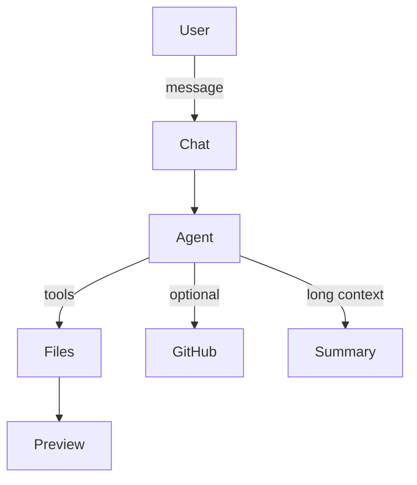

# W-Code

Free open-source AI coding agent with live preview.  
Chat on the left, see the result on the right.

[](LICENSE)
[](package.json)

---

## What it does

W-Code is a local coding agent you control.  
You talk to it, it reads and writes files, runs commands, and the preview updates live.

It supports many model providers, connects to GitHub, has project templates, and follows a design system that avoids common AI-generated look.

## Screenshot

<div align="center">
  
</div>

## Features

- Multi-provider (OpenAI, Anthropic, Groq, OpenRouter, xAI, Ollama, Gemini, DeepSeek, Mistral, Together)
- Live preview pane
- GitHub connect + push selected files
- Local Git (status, diff, commit)
- Project templates (PHP+SQLite, Node API, Static site, React)
- Design system and anti-slop rules
- Automatic conversation summarization for long sessions
- File tree with target file selection
- Dark / light theme
- Electron desktop build

## Install and run

```bash
git clone https://github.com/withermen/W-Code.git
cd W-Code
npm install
npm start
```

Open http://localhost:3000

Add your API key in the settings panel (gear icon). Keys stay in the browser.

### Build desktop app

```bash
npm install
npm run build:win
```

The installer appears in the `dist` folder.

## Supported providers

| Provider       | Type                  |
|----------------|-----------------------|
| OpenAI         | Streaming + tools     |
| Anthropic      | Claude + tool use     |
| Groq           | Fast inference        |
| OpenRouter     | Many models           |
| xAI            | Grok                  |
| Ollama         | Local models          |
| Google Gemini  | OpenAI-compatible     |
| DeepSeek       | Code models           |
| Mistral        | Large models          |
| Together AI    | Open models           |

## Using GitHub

1. Click the **GH** button.
2. Paste a Personal Access Token with `repo` scope.
3. Connect and choose a repository.
4. Click a file in the tree to set it as the target.
5. Push the file to the selected repository.

## How the agent works



## Folder layout

```
src/server/       Express server and routes
src/providers/    Model provider adapters
src/tools/        File, shell, git, and design tools
src/agents/       Agent loop
src/github/       GitHub API client
src/git/          Local git commands
src/context/      Conversation summarizer
src/templates/    Starter project templates
public/           Web interface
prompts/          System prompt
design-system/    Color and type tokens
examples/         PHP and SQL samples
electron/         Desktop wrapper
```

## Design rules

The agent is instructed to avoid typical AI-generated patterns:

- No purple or indigo gradients
- No Inter / Roboto as the only font
- No three identical feature cards
- No generic marketing phrases

It prefers specific, readable, intentional interfaces.

## License

Apache License 2.0. See the [LICENSE](LICENSE) file.
