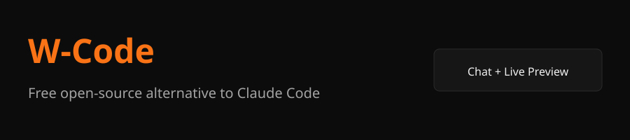
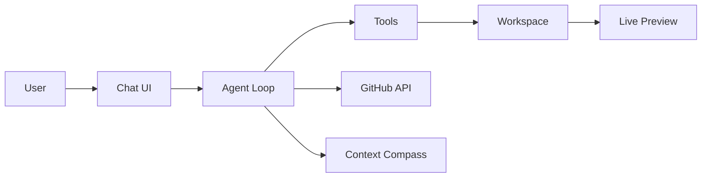

# W-Code

**Free open-source alternative to Claude Code.**

Left: full agent chat with multi-provider support.  
Right: live browser preview that updates as the AI builds.

[](LICENSE)
[](package.json)
[](#providers)

---

<div align="center">
  
</div>

## Features

- **Multi-provider** — OpenAI, Anthropic, Groq, OpenRouter, xAI, Ollama, Gemini, DeepSeek, Mistral, Together
- **Live preview** — Right panel updates as files are written
- **GitHub integration** — Connect with token, select repo, push files
- **Local Git** — Status, diff, commit
- **Project templates** — PHP+SQLite, Node API, Static site, React
- **Design system** — Intentional tokens, anti-AI-slop rules
- **Context compass** — Auto-summarizes long conversations (~170k tokens)
- **File explorer** — Tree view, target file selection
- **Settings** — API keys, theme (dark/light), temperature
- **Desktop** — Electron support for `.exe`

## Quick Start

```bash
git clone https://github.com/withermen/W-Code
cd W-Code
npm install
cp .env.example .env   # optional
npm start
```

Open http://localhost:3000

### Desktop (.exe)

```bash
npm install
npm run build:win
```

Output in `dist/`.

## Providers

| Provider | Notes |
|----------|-------|
| OpenAI | Streaming + tools |
| Anthropic | Claude + tool use |
| Groq | Fast Llama |
| OpenRouter | Many models |
| xAI / Grok | Grok models |
| Ollama | Local |
| Google Gemini | Via OpenAI-compatible |
| DeepSeek | Code-focused |
| Mistral | Large models |
| Together AI | Llama etc. |

Set API keys in the ⚙ panel (stored in browser).

## GitHub Integration

1. Click **GH**
2. Paste a Personal Access Token (repo scope)
3. Connect → select a repository
4. Click a file in the explorer (sets target)
5. **Push target file to GitHub**

## Architecture



## Project Structure

```
src/
├── server/          # Express + SSE
├── providers/       # Multi-provider layer
├── tools/           # File, shell, git, design tools
├── agents/          # Agent loop
├── github/          # GitHub API
├── git/             # Local git
├── context/         # Compass summarizer
├── templates/       # Project starters
└── sessions/        # Multi-project
public/              # Frontend
prompts/             # System prompt
design-system/       # Tokens + DESIGN.md
examples/            # PHP / SQL samples
electron/            # Desktop wrapper
```

## Philosophy

- Intentional over average
- No AI slop (no purple gradients, no Inter-only, no three identical cards)
- Describe → Approve → Apply → Preview
- Accessibility and readability first

## License

Apache License 2.0. See [LICENSE](LICENSE).

---

<div align="center">
  <strong>Built for people who want a coding agent they control.</strong>
</div>
